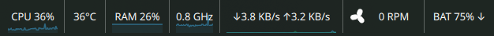

# Glance

Your machine at a glance: a compact KDE Plasma 6 panel widget that puts CPU usage, memory,
temperature and more in one strip, with a details popup.



- **Stats:** CPU usage, memory and CPU temperature by default. CPU frequency, network speed, battery
  and fan speed (with a spinning fan icon) can be switched on. Battery and fan only appear on
  machines that have them.
- **Yours to arrange:** choose what shows in the panel and in the popup, and drag the stats into
  the order you want. Optional line graphs can be switched on per stat.
- **Fits your panel:** set a maximum length (in the settings, or by dragging a handle on the strip)
  and the strip shortens its text, then hides the last stats, instead of growing too long.
- **Horizontal or vertical panels:** one line with thin dividers, or stacked captioned blocks.
- **Click for a popup** with used / total memory, average and hottest-core temperature, a per-core
  list, and the details of the other stats.
- A temperature turns red when it reaches a threshold you set.
- Pure QML. No native code, no background processes: values come from KDE's own sensor service
  and power-management engine.

## Requirements

- **KDE Plasma 6.** Developed and tested on Plasma 6.8; it declares Plasma 6.0 as the minimum but has not
  been tried on older 6.x releases. It does not work on Plasma 5.
- These Plasma / KDE Frameworks 6 components, which a normal Plasma 6 desktop already includes. If the
  widget shows a "There was an error loading" message, one of them is missing. Package names on
  Fedora, for reference (other distributions name them differently):

  | Needed for | Component | Fedora package |
  |---|---|---|
  | Installing | `kpackagetool6` | `kf6-kpackage` |
  | CPU, memory, temperature, frequency, network, fan values | `org.kde.ksysguard.sensors` | `libksysguard` |
  | Graphs | `org.kde.quickcharts` | `kf6-kquickcharts` |
  | Sensor discovery (fan) | `org.kde.kitemmodels` | `kf6-kitemmodels` |
  | Battery | `org.kde.plasma.plasma5support` (power-management engine) | `plasma5support` |
  | Settings pages | `org.kde.kirigami`, `org.kde.kcmutils` | `kf6-kirigami`, `kf6-kcmutils` |

- `python3` (the install, uninstall and package scripts read `metadata.json` with it), and `zip`, `unzip` and
  `du` (only `./package.sh` needs these).
- Hardware, all optional: a CPU temperature sensor that KDE System Monitor can read, a fan sensor
  (from lm_sensors), and a battery. A stat the machine cannot supply simply shows `--` or, for battery
  and fan, does not appear in the settings at all.

## Install

The widget installs for your user only (into `~/.local/share/plasma/plasmoids/org.local.cpumemtemp/`),
so no root access is needed. Pick one of these ways.

### From the project folder

```
git clone https://github.com/balazsvrg/plasma-glance.git
cd plasma-glance
./install.sh
```

`install.sh` installs the widget, or upgrades it in place if it is already installed.

### From the package

If you were given a `.plasmoid` file (or built one with `./package.sh`, see below):

```
kpackagetool6 -t Plasma/Applet -i org.local.cpumemtemp-0.8.2.plasmoid
```

Use `-u` instead of `-i` to upgrade an installed copy. You can also do it from Plasma: right-click the
panel, choose **Add Widgets**, then **Get New Widgets > Install from Local File**.

To install it for every user on the machine, add `-g` and run the command as root:

```
sudo kpackagetool6 -t Plasma/Applet -g -i org.local.cpumemtemp-0.8.2.plasmoid
```

### Then load it into Plasma

Plasma only notices a new or upgraded widget when it restarts. Reload it with:

```
kquitapp6 plasmashell; kstart plasmashell
```

This blanks the desktop and panels for a second or two; logging out and back in does the same job.
Your open applications are not affected.

Then right-click the panel, choose **Add Widgets**, search for **Glance** and drag it
onto the panel. It is designed for a panel; placing it elsewhere has not been tested.

### Check it worked

```
kpackagetool6 -t Plasma/Applet --list | grep cpumemtemp                      # is it installed?
grep Version ~/.local/share/plasma/plasmoids/org.local.cpumemtemp/metadata.json   # which version?
plasmawindowed org.local.cpumemtemp                                           # open it in a plain window
```

### Upgrade

Run `./install.sh` again (or `kpackagetool6 ... -u` with a new package), then reload Plasma as above.
Your settings are kept.

### Uninstall

Remove the widget from your panels first, then:

```
./uninstall.sh                                        # from the project folder, or
kpackagetool6 -t Plasma/Applet -r org.local.cpumemtemp
```

and reload Plasma. (A system-wide install needs `sudo ... -g -r` instead.)

### Troubleshooting

- **It is not in the Add Widgets list:** Plasma has not reloaded yet. Run the reload command above.
- **The widget shows "Sorry! There was an error loading ...":** a component from the requirements table is
  missing, or the install is damaged. Run `plasmawindowed org.local.cpumemtemp` in a terminal: the error is
  drawn inside the window it opens, not printed to the terminal. Install the missing package and reload.
- **A stat shows `--` or a value of 0:** that sensor is not available on this machine, or has not reported
  yet. Give it a few seconds after loading.
- **There is no Battery or Fan row in Configure > Metrics:** the widget did not find that hardware. It
  looks for a fan for about half a minute after Plasma starts.

### Package

`./package.sh` builds `dist/org.local.cpumemtemp-<version>.plasmoid` (a zip with `metadata.json` and
`contents/` at its top level, named after the id and version in `metadata.json`). Bump the version in
`metadata.json` first. The `dist/` folder is not tracked by git. The author, website and bug-report
URL in `metadata.json` point at the GitHub repository.

## Settings

Right-click the widget in the panel and choose **Configure…**. There are three tabs: General, Metrics and Graphs.

**General**

| Setting | Default |
|---|---|
| Temperature unit | °C |
| Network speed unit: bytes (MB/s) or bits (Mb/s) | bytes |
| Warning threshold (always entered in °C) | 80 |
| Maximum length (px) of the panel strip; 0 = no limit | no limit |
| Refresh interval | 1000 ms (250 to 10000) |

The refresh interval applies to the sensors; the battery comes from the power-management engine, which the
widget polls every 5 seconds whatever the setting.

**Metrics**: a table with one row per stat. Each stat has four checkboxes: whether it is **shown** in the
panel and in the popup, and whether each of those gets a **graph**. An *All graphs* row turns
every graph on or off in one click. Graphs are off by default.

**Reordering:** drag a row by its handle (or use the up and down arrows) to set the order of the stats.
The order is used in the panel (left to right), in the popup (top to bottom) and in the tooltip. The hottest-core and
per-core rows move with CPU temperature. When space is short, stats at the bottom are hidden first.

| Stat | Panel | Popup |
|---|---|---|
| CPU usage, memory, CPU temperature | on | on |
| CPU frequency | off | off |
| Network speed (all interfaces combined) | off | off |
| Battery (laptops only; hidden when none is found) | off | off |
| Fan speed (hidden when no fan sensor is found) | off | off |
| Hottest core, per-core temperatures | n/a | on |

Turning off per-core temperatures also stops its sensors.

**Fan speed** shows the RPM of the fastest fan next to a small three-blade fan icon, drawn in QML.
The icon stands still at 0 RPM and spins faster, and looks faster, as the fan does:

| Fan speed | Icon |
|---|---|
| under 2500 RPM | plain blades, slow spin |
| 2500 to under 4000 RPM | medium spin with a faint motion-blur trail |
| 4000 RPM and over | fast spin, two blur trails, a soft blurred disc, a small shake and swirling speed lines |

The animation is stepped at about 12 frames per second to keep it cheap. Turn it off with
*Animate fan icon based on fan speed* in the Metrics tab; the icon then stays a plain still fan.
Fans are discovered from the sensor tree (`lmsensors/<chip>/fanN`), so no hardware names are
hard-coded.

On a laptop with **several batteries**, the Metrics tab also offers *Popup battery view*:
**Combined** (default) or **Each battery separately**. The panel always shows the combined
percentage, with ↑ while charging and ↓ while discharging, and turns red below 15% unless
charging. The popup shows energy held, state and the time estimate (to full, or left).

**Graphs** (which stats get a graph is chosen in the Metrics tab)

| Setting | Default |
|---|---|
| Panel graph style: Behind text / Inline | Behind text |
| History length: 30 s / 1 min / 5 min | 1 min |

Graph history is collected only for stats that a graph shows, and starts once that stat's
sensor reports a real value, so a missing sensor never blocks the other graphs. The graphs span the samples collected so far and then scroll.
On a vertical panel, "inline" puts the graph below the text.

**Maximum length** limits the strip along the panel (width on a horizontal panel, height on a
vertical one). When the strip would be longer, it saves space in steps and stops at the first step
that fits:

1. Inline graphs become behind-text graphs, which take no length.
2. Compact text, still readable: `CPU 8%` becomes `C 8%`, `RAM` becomes `R`, `2.2 GHz` becomes
   `2.2G`, `↓4.5 MB/s ↑3 KB/s` becomes `↓4.5M ↑3K`, `BAT 14% ↑` becomes `B 14%↑`, `2400 RPM`
   becomes `2400` next to the fan icon.
3. Tighter spacing.
4. If it still does not fit, stats are dropped from the end of the strip (Fan, Battery, Network,
   Frequency, Temperature, Memory in the default order). The first stat in your order is never dropped.

The tooltip (title "System stats") lists the stats switched on for the panel, including ones the limit
hid from the strip, but not stats you switched off. With the limit at 0 nothing changes.

**The settings say so when the limit is changing what you see.** If the limit currently turns inline
graphs into behind-text ones, shortens the text, or hides stats (with their graphs), a warning at the
top of the General and Metrics tabs lists exactly what, and the Metrics table marks each hidden stat
with "hidden by the maximum length". It reflects the saved limit and the widget's current layout, so it updates after you press Apply (not while you type in the field).

**Setting it with the mouse:** right-click the widget and choose **Adjust length with the mouse**.
A handle appears on the strip's free edge: the right edge when the widget sits in the left half
of the panel, the left edge when it sits in the right half (bottom or top edge on a vertical
panel). Drag it
and the strip resizes live, compacting and dropping stats as it goes, with a small readout of the
limit in pixels. A step down only happens once the pointer has gone at least halfway from where the
current layout fits to where the next shorter one fits, so a small nudge never makes the strip jump;
growing back is immediate once a longer layout fits. The value is saved when you let go (what you see
is what is saved). Dragging out to the full length means "no
limit", and double-clicking the handle resets to no limit. Adjust mode switches itself off about 12
seconds after you turn it on or after your last drag (the timer only pauses while you are dragging;
hovering does not reset it), or untick the menu entry.

## Documentation

Full documentation is in [`docs/`](docs/README.md): a user guide, a settings reference, an architecture
guide for developers, and a development and release guide.

## Develop

```
kpackagetool6 -t Plasma/Applet -u package   # reinstall after edits
plasmawindowed org.local.cpumemtemp                      # test in a plain window
```

`plasmawindowed` cannot simulate a vertical panel. To check that layout, move a
panel to a screen edge or add a temporary vertical panel.

Sensor IDs used (check with `kstatsviewer --list`):
`cpu/all/usage`, `memory/physical/usedPercent`, `memory/physical/used`,
`memory/physical/total`, `cpu/all/averageTemperature`, `cpu/all/maximumTemperature`,
`cpu/all/coreCount`, `cpu/cpuN/temperature`,
`cpu/all/averageFrequency`, `cpu/all/minimumFrequency`, `cpu/all/maximumFrequency`,
`lmsensors/<chip>/fanN` (discovered),
`network/all/download`, `network/all/upload`, `network/all/totalDownload`, `network/all/totalUpload`.
Battery data comes from Plasma's power-management engine (`powermanagement`, via
`org.kde.plasma.plasma5support`), the same source KDE's own battery widget uses. KDE's
`power/<id>/...` sensors were not used: on one test laptop they lagged behind the kernel
and disagreed with it. The engine does not report watts, so the popup shows no power draw.
Graphs use KDE Quick Charts (`org.kde.quickcharts`: `LineChart`, `HistoryProxySource`).

## Layout

```
package/
  metadata.json                 widget id, name, API version
  contents/config/main.xml      settings schema and defaults
  contents/config/config.qml    registers the settings pages
  contents/ui/main.qml          panel view, popup, sensors
  contents/ui/configGeneral.qml settings tab: General
  contents/ui/configMetrics.qml settings tab: Metrics
  contents/ui/configGraphs.qml  settings tab: Graphs
  contents/ui/LengthNotice.qml  settings notice about the maximum length
install.sh / uninstall.sh
package.sh                      builds the .plasmoid into dist/
```

## Changelog

**0.8.2**
- First public release. The widget itself is unchanged.
- The plugin folder is now `package/`, the licence text (GPL-2.0) ships as `LICENSE`, and `metadata.json`
  carries the author, website and bug-report URL.
- The README shows the widget in a panel.

**0.8.1**
- The saved battery count is now refreshed from the first battery reading after the widget loads. A
  configuration copied from a laptop to a machine without a battery no longer keeps showing the Battery row
  and the "Popup battery view" option in the Metrics tab.

**0.8**
- CPU frequency is always shown in GHz (`0.8 GHz`), so it no longer spills out of its reserved width when
  the CPU idles below 1 GHz.
- A plain click (or a cancelled press) on the maximum-length handle no longer rewrites the saved length;
  only an actual drag does.
- The Metrics arrow buttons skip the hidden Battery and Fan rows instead of silently swapping with them, and
  are disabled at the ends.
- Network rates never show `1000 KB/s`; they roll over to the next unit.
- Fan discovery needs two identical scans before it settles, so a second fan chip that appears a moment
  later is no longer missed.
- Sensors used only by the popup are read only while the popup is open.

**0.7**
- Vertical panels: each stat keeps its name above the value, and a value is shortened (`42°C` becomes `42°`,
  `2.2 GHz` becomes `2.2G`) only when it is wider than the panel is thick.
- Fixed the strip overlapping or scrambling after switching the panel from vertical to horizontal while the
  widget was running.
- The settings notice about the maximum length no longer claims text is shortened on a vertical panel, and it
  mentions when the spacing between stats is tightened.

**0.6**
- Renamed to **Glance**. The internal plugin ID is unchanged, so an existing panel widget keeps working
  with all its settings; the source folder was renamed too.
- A full installation guide in this README, and `package.sh` to build a `.plasmoid` file.
- Cleanup and efficiency: sensors that nothing shows are switched off, hidden stats build no cells, the
  popup graphs share one component, and the drag no longer recomputes its layouts on every mouse move.
  Nothing should look different.

**0.5**
- Reorder the stats: the Metrics tab is a table whose rows can be dragged (or moved with arrows). The order
  drives the panel strip, the popup and the tooltip, and decides which stats are hidden first when space is
  short; the first stat in your order is never hidden.
- The table is styled like a Dolphin file list: an outline, a slightly darker inside and alternating row colours.
- More robust fan detection (retries at login, unloads once found), optional sensors only run while something
  shows them, and the network graph scale decays in real time.

**0.4**
- New stats, all off by default: CPU frequency, network speed (all interfaces, bytes or bits), battery
  (combined, or each battery separately in the popup; laptops only) and fan speed with a three-speed
  spinning fan icon that blurs, shakes and throws speed lines as the fan speeds up.
- The Metrics tab (replaces the Popup tab): one row per stat with Show and Graph checkboxes for the panel
  and the popup, and an All graphs row. Graphs are now chosen per stat; the Graphs tab only holds the style
  and history length.
- Maximum length: limits the strip with readable compaction steps (inline graphs go behind the text,
  compact text, tight spacing), then drops stats from the end. Set it in General or by dragging a handle on
  the strip's free edge (right-click > Adjust length with the mouse), with a halfway rule so small nudges
  do not make the strip jump.
- The settings warn when the limit is changing what you see, and mark each hidden stat.
- Power-management data source for the battery (KDE's ksystemstats power sensors disagreed with the kernel).

**0.3**
- Optional line graphs: in the panel (Behind text or Inline) and under each popup item.
- New Graphs settings tab: panel style, popup graphs, history length (30 s, 1 min, 5 min).
- Per-stat history, collected only for stats a graph shows.

**0.2**
- Per-core temperatures in the popup.
- Popup settings tab: toggle every popup item.

**0.1**
- Panel strip with CPU, memory and temperature, popup, General settings, vertical panel layout.
